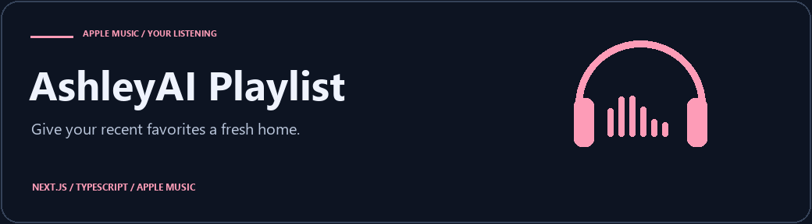

<div align="center">



# AshleyAI Playlist

**Give your recent favorites a fresh home.**


[Overview](#overview) &nbsp; · &nbsp; [Run locally](#run-locally) &nbsp; · &nbsp; [Explore the repository](https://github.com/mcampo0215/AshleyAI-Playlist)

</div>

---

## Overview

An Apple Music playlist project with MusicKit authorization, a connected-library preview, and a manual refresh flow for an AshleyAI Weekly Mix. The server signs developer tokens and uses the connected music account to create or update a playlist.

| Connect | Preview | Refresh |
| :--- | :--- | :--- |
| Authorize Apple Music through MusicKit in the browser. | Find AshleyAI Weekly Mix and load its tracks from the connected library. | Add a deduplicated selection from recently played tracks. |

## Run locally

Install Node.js and npm, then:

```sh
npm ci
```

Create `.env.local` using [.env.example](.env.example) as a reference:

```dotenv
APPLE_TEAM_ID=YOUR_APPLE_TEAM_ID
APPLE_MUSICKIT_KEY_ID=YOUR_MUSICKIT_KEY_ID
APPLE_MUSICKIT_PRIVATE_KEY_P8_B64=YOUR_BASE64_ENCODED_PRIVATE_KEY
```

These values require your Apple developer / MusicKit setup. Keep the private key on the server and outside commits. The signing code also supports `APPLE_MUSICKIT_PRIVATE_KEY_P8` with PEM content.

```sh
npm run dev
```

Open `http://localhost:3000`, then connect an eligible Apple Music account. The connection screen is `/connect/apple-music`.

## Inside the project

| Source | Responsibility |
| :--- | :--- |
| [src/components/apple-music-showcase.tsx](src/components/apple-music-showcase.tsx) | Connection and playlist interface. |
| [src/lib/playlist.ts](src/lib/playlist.ts) | Paginated lookup of the weekly playlist and its tracks. |
| [src/lib/apple.ts](src/lib/apple.ts) | Apple Music API helpers. |
| [src/app/api/weekly-refresh/route.ts](src/app/api/weekly-refresh/route.ts) | Developer-token signing and playlist refresh. |
| [src/lib/storage.ts](src/lib/storage.ts) | Process-local token and playlist state. |

## Current behavior

The refresh route reads up to 30 recently played tracks and selects up to 20 distinct track IDs for addition. The `weekly` name does not imply a scheduler: the current interface refreshes on request. Token storage is an in-memory map and the refresh route uses a fixed demo user ID, so durable multi-user isolation is not implemented here.

The existing hosted project link is [Playlist Generator](https://ashley-ai-playlist-d5jxc3zm8-mcampo0215s-projects.vercel.app); deployment availability may depend on its access settings.

## Checks

```sh
node --test tests/playlist.test.mjs
npm run lint
npm run build
```

---

<p align="center"><a href="#ashleyai-playlist">Back to the top</a></p>
